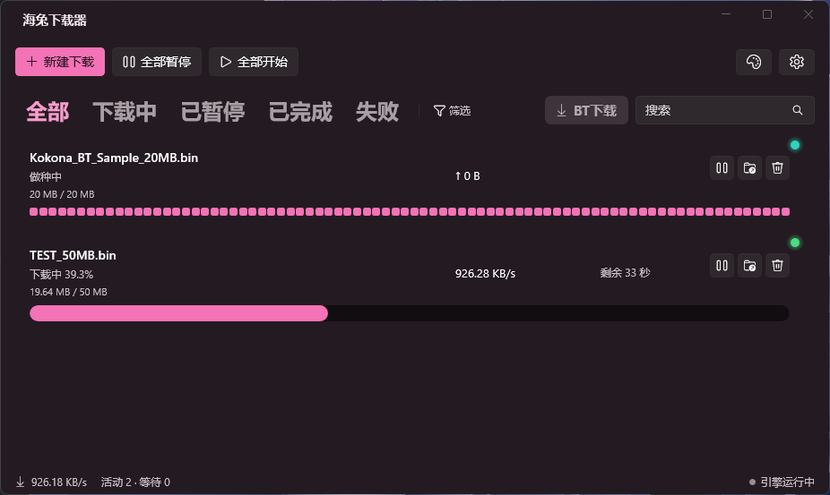

# 海兔下载器

一款 Windows 下载工具：点击浏览器里的下载链接，文件自动交给桌面客户端，用自研分段引擎多线程下载；BT / 磁力交给内置的 aria2。



**当前版本**：客户端 1.1.3 · 浏览器扩展 2.1.1

**它能做什么：**

- 浏览器里点击下载，自动交给桌面客户端处理（Cookie / UA 随请求带上，需要登录的站点也能下）
- 自研分段引擎：HTTP/HTTPS/FTP 多连接分段、断点续传、镜像轮转
- 续传前校验 ETag / Last-Modified / 长度，远端变了就整体重下，不产出坏文件
- BT / 磁力由 aria2 负责，支持做种、tracker 热更新
- 内置多种主题配色，支持深色模式与磨砂透明
- 小巧的独立进度浮窗，不影响你做别的事
- 下载完成弹通知，一键打开所在文件夹
- 系统托盘常驻，图标外圈显示总进度，右键快捷菜单
- 单文件便携版：一个 exe 直接双击运行，无需安装

---

### 常用操作

- **双击任务文件名**：在资源管理器里打开文件所在位置并选中该文件
- **托盘单击**：唤出主窗口
- **右键托盘图标**：快捷菜单（显示主界面 / 全部暂停 / 全部继续 / 退出）；菜单开着时再次右键即收起

### 首次配对扩展

1. 启动海兔客户端
2. 客户端「设置 → 浏览器扩展连接」里复制密钥
3. 点浏览器工具栏的海兔图标 → 点「粘贴密钥并连接」（扩展直接读剪贴板并验证）
4. 状态点变绿即成功

可选但强烈建议：点「授权访问网站（用于带上登录 Cookie）」，否则需要登录的站点会拿到登录页而不是文件。

---

## 开发者指南

### 软件架构

```
┌─────────────────┐         HTTP            ┌──────────────────────────┐
│  浏览器扩展     │  ═══════════════════════► │  桌面客户端 (WinUI 3)     │
│  (Manifest V3)  │     (本地 API + 密钥)    │  .NET 8 + WASDK          │
└─────────────────┘                         └────────────┬─────────────┘
                                                         │
                              ┌──────────────────────────┴───────────────┐
                              │                                          │
                    HTTP/HTTPS/FTP（进程内）                 BT / 磁力（JSON-RPC）
                              │                                          │
                    ┌─────────┴─────────┐                    ┌───────────┴────────┐
                    │  自研分段引擎      │                    │    Aria2 引擎       │
                    │  IdmHttpDownloader │                    │   (aria2c.exe)     │
                    └───────────────────┘                    └────────────────────┘
```

- **浏览器扩展**：拦截浏览器的 `downloads` 事件，采集 Cookie / UA / Accept-Language，通过 HTTP 把下载请求发给桌面客户端。Manifest V3，纯原生 JS，无构建步骤。
- **桌面客户端**：WinUI 3 桌面应用，负责 UI、任务管理、系统通知、托盘图标。内部运行本地 HTTP API 服务器，接收扩展请求。
- **自研分段引擎**：进程内实现，负责 HTTP/HTTPS/FTP。分段调度、断点续传、内容校验、镜像轮转、FTP REST 续传、HTTP/2、跨卷落盘都在这里。
- **Aria2 引擎**：独立 aria2c 进程，通过 JSON-RPC 调用，负责 BT / 磁力（以及可关闭的旧路径）。

### 技术实现

| 组件 | 技术栈 |
|------|--------|
| 桌面客户端 | C# / .NET 8 / WinUI 3 / Windows App SDK |
| 浏览器扩展 | JavaScript / Manifest V3 |
| 下载引擎 | 自研分段引擎（HTTP/HTTPS/FTP）+ Aria2（BT / 磁力，GPL v2） |
| 客户端 ↔ 扩展 | HTTP REST API，本地回环地址，带密钥鉴权 |
| 客户端 ↔ Aria2 | JSON-RPC（HTTP POST，本地回环） |

### 目录结构

```
├── src/
│   ├── KokonaDownloader.App/         WinUI 3 桌面客户端（含托盘、浮窗、设置）
│   ├── KokonaDownloader.Core/        核心库：分段引擎、Aria2 封装、设置、本地 API
│   │   └── Engine/Idm/               自研分段引擎（IdmHttpDownloader / ChunkTable 等）
│   ├── KokonaDownloader.Core.Tests/  单元测试（xunit）
│   └── KokonaDownloader.UiTests/     UI 冒烟测试（手动运行的界面辅助程序）
├── extension-v2/                     浏览器扩展源码（现行版本，直接加载即可用）
│   └── test/                         扩展单元测试（node:test）
├── extension/                        旧版扩展，已废弃，不要再改
├── tools/                            验收脚本（DNR / 登录态 / 真实站点 / 性能 / 扩展打包）
├── vendor/aria2/                     Aria2 引擎二进制
├── screenshot/                       产品截图
├── icons/                            应用图标
├── build.ps1                         一键构建脚本（客户端 + 扩展）
└── README.md                         本文档
```

### 本地构建

需要 [.NET 8 SDK](https://dotnet.microsoft.com/download)。

```powershell
# 一键构建（客户端发布目录 + 扩展目录）
powershell -ExecutionPolicy Bypass -File .\build.ps1

# 产物：
#   dist\KokonaDownloader\KokonaDownloader.exe   桌面客户端
#   dist\KokonaExtension\                        浏览器扩展目录

# 单文件便携版（本仓库设了 EnableMsixTooling=false 并自行嵌入 resources.pri，
# 必须带最后一项跳过 Windows App SDK 的单文件配置校验，否则构建期直接报错）
dotnet publish src\KokonaDownloader.App\KokonaDownloader.App.csproj `
  -c Release -r win-x64 `
  -p:PublishSingleFile=true `
  -p:IncludeNativeLibrariesForSelfExtract=true `
  -p:WindowsAppSDKSingleFileVerifyConfiguration=false `
  -o dist\KokonaSingleFile

# 打包扩展为 zip（自写 zip 写入器，条目分隔符一律 /）
node tools\pack_extension.mjs
```

浏览器扩展无需构建，把 `extension-v2/` 加载为「解压缩的扩展」即可；首次需按上面的"首次配对"完成密钥连接。

### 测试

```powershell
# 核心单测（约 10 分钟，测试串行执行）
dotnet test src\KokonaDownloader.Core.Tests\KokonaDownloader.Core.Tests.csproj

# 扩展单测（约 6 秒）
cd extension-v2
node --test test/logic.test.mjs test/force-attachment.test.mjs test/sw.test.mjs

# 真实站点下载（10 类站点，需客户端在跑）
node tools\real_sites_test.mjs

# 性能基准（连接数 → 吞吐 / CPU / 内存，需客户端在跑）
node tools\perf_bench.mjs --size=128 --cases=1,2,4,8,16
```

跑核心单测前建议先清掉代理变量，避免环境差异干扰结果：

```powershell
Remove-Item Env:HTTP_PROXY,Env:HTTPS_PROXY,Env:ALL_PROXY,Env:http_proxy,Env:https_proxy,Env:all_proxy -ErrorAction SilentlyContinue
```

---

## 开源协议

本项目采用 **MIT 协议** 开源。

> 注意：软件内置的 Aria2 下载引擎（`vendor/aria2/aria2c.exe`）是独立的第三方组件，遵循其自身的 [GPL v2](https://github.com/aria2/aria2/blob/master/COPYING) 许可证。海兔下载器通过 JSON-RPC 协议与 Aria2 进程通信，两者在许可证层面相互独立。
